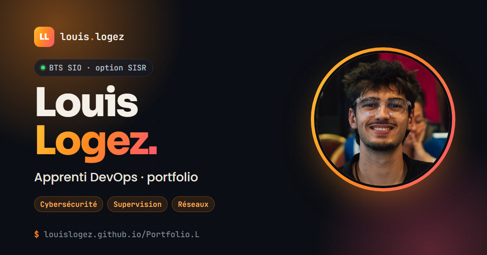

# Portfolio BTS SIO — Louis LOGEZ

**[Voir le portfolio en ligne →](https://louislogez.github.io/Portfolio.L/)**



Portfolio de Louis LOGEZ, étudiant en deuxième année de **BTS SIO option SISR**
(Solutions d'Infrastructure, Systèmes et Réseaux) au lycée Dick Ukeiwë de Dumbéa, en
Nouvelle-Calédonie, et **apprenti DevOps** à la Société Générale Nouvelle-Calédonie.
Il présente mon parcours, mes réalisations et les compétences du référentiel mobilisées
pour les épreuves E5 et E6 (session 2026).

Site statique en HTML, CSS et JavaScript natif, sans dépendance ni outil de build,
publié avec GitHub Pages.

## Contenu du site

| Page | Ce qu'on y trouve |
|---|---|
| [Accueil](https://louislogez.github.io/Portfolio.L/) | Présentation, chiffres clés, terminal interactif et accès aux rubriques |
| [À propos](https://louislogez.github.io/Portfolio.L/apropos.html) | Profil, objectif professionnel, formations, expériences filtrables, CV et loisirs |
| [Parcours](https://louislogez.github.io/Portfolio.L/stages.html) | Le fil rouge du bac au premier poste : BTS SIO, stage puis alternance à la SGNC |
| [Réalisations](https://louislogez.github.io/Portfolio.L/projets.html) | Grille filtrable avec zooms détaillés : TP E6 DNS Bind9 et supervision Zabbix, conformité NIST, supervision de microservices, HIDS Wazuh, Pendu numérique… |
| [Compétences](https://louislogez.github.io/Portfolio.L/competences.html) | Les trois blocs du référentiel et le tableau de synthèse E5 (téléchargeable) |
| Blocs [1](https://louislogez.github.io/Portfolio.L/patrimoine.html), [2](https://louislogez.github.io/Portfolio.L/infrastructure.html) et [3](https://louislogez.github.io/Portfolio.L/cybersecurite.html) | Fiches techniques complètes : contexte, choix, mise en œuvre, tests, difficultés et résultat |
| [Veille](https://louislogez.github.io/Portfolio.L/veille.html) | L'IA au service et à l'épreuve de la cybersécurité : 12 articles commentés, filtrables par axe, synthèse et méthode de veille |
| [Contact](https://louislogez.github.io/Portfolio.L/contact.html) | E-mail, LinkedIn, GitHub et formulaire de contact |

## Fonctionnalités

- **Thème clair ou sombre**, avec mémorisation du choix du visiteur.
- **Terminal interactif** sur l'accueil : `help`, `whoami`, `skills`, `neofetch`, `cd realisations`…
- **Filtres** sur les expériences, les réalisations et les axes de veille.
- **Zooms repliables** et **onglets de code** pour détailler les projets sans alourdir les pages.
- **Coffres chiffrés** pour les contenus confidentiels (voir plus bas).
- **Formulaire de contact sans serveur** : il prépare l'e-mail et ouvre la messagerie du visiteur.
- **Aperçu de lien** (Open Graph) quand l'adresse est partagée sur LinkedIn ou une messagerie.
- **Page 404** personnalisée pour les adresses inconnues.
- **Version imprimable** propre de chaque page.

## Confidentialité : les coffres

Une partie de mes réalisations porte sur des environnements réels : systèmes d'une banque
en production, infrastructure du BTS. Les éléments sensibles (adressage, configurations,
failles connues, documents internes) ne sont **jamais publiés en clair**.

Ils sont chiffrés par `outils/chiffrer-coffres.ps1` (PBKDF2-SHA256, AES-256-CBC et
HMAC-SHA256), puis déchiffrés dans le navigateur avec l'API WebCrypto, uniquement après
saisie du mot de passe. Sans lui, le code source ne contient que des données chiffrées :
un simple flou CSS, à l'inverse, laisserait le texte lisible dans la page.

Le fonctionnement détaillé est décrit dans [`outils/LISEZ-MOI.md`](outils/LISEZ-MOI.md).

## Choix techniques

- **Aucune dépendance JavaScript.** `theme.js` et `fx.js` sont chargés en `defer`, en
  JavaScript natif (Canvas, `IntersectionObserver`, WebCrypto), sans librairie ni build.
- **Deux feuilles de style.** `style.css` porte la base, les thèmes et la mise en page ;
  `fx.css` les composants et les effets de chaque page. Aucun style dupliqué dans les pages.
- **Thèmes par variables CSS.** Les couleurs sont définies sur `:root` et redéfinies sur
  `:root[data-theme="dark"]` : le mode sombre s'applique à tous les composants.
- **Effets séparés du contenu.** Sans `fx.css` et `fx.js`, le site reste lisible et
  utilisable.
- **Accessibilité.** Lien d'évitement, `aria-current` sur la page active, focus visible au
  clavier, `prefers-reduced-motion` respecté et texte alternatif sur toutes les images.
- **Responsive.** Chaque page est vérifiée sur ordinateur et sur mobile, sans défilement
  horizontal.

## Structure

```
Portfolio.L/
├── index.html              Accueil
├── apropos.html            Profil, formations, expériences, CV
├── stages.html             Parcours
├── projets.html            Réalisations
├── competences.html        Vue d'ensemble et tableau de synthèse E5
├── patrimoine.html         Bloc 1 — Support et mise à disposition de services
├── infrastructure.html     Bloc 2 — Administration des systèmes et des réseaux
├── cybersecurite.html      Bloc 3 — Cybersécurité des services informatiques
├── veille.html             Veille technologique
├── contact.html            Contact
├── 404.html                Page d'erreur, servie par GitHub Pages pour toute adresse inconnue
├── assets/
│   ├── css/style.css       Base, thèmes clair et sombre, mise en page
│   ├── css/fx.css          Composants, effets et styles propres à chaque page
│   ├── js/theme.js         Bascule de thème
│   ├── js/fx.js            Interactions : filtres, zooms, onglets, terminal, coffres, formulaire
│   ├── img/                Images et aperçu de lien
│   └── docs/               CV, tableau de synthèse E5, documents protégés (*.enc)
└── outils/
    ├── chiffrer-coffres.ps1  Chiffrement des coffres et des documents protégés
    └── LISEZ-MOI.md          Mode d'emploi des coffres
```

Le dossier `prive/`, qui contient les versions en clair des coffres, reste sur mon poste :
il est exclu du dépôt par le `.gitignore`.

## Mise en ligne

Le site est publié par **GitHub Pages** depuis la branche `main`, à la racine du dépôt.
Chaque `git push` déclenche une nouvelle publication, visible en une à deux minutes
(un `Ctrl` + `F5` force le navigateur à recharger les styles).

Pour le consulter en local, il suffit d'ouvrir `index.html` dans un navigateur, ou de
servir le dossier avec un petit serveur local (par exemple l'extension *Live Server* de
VS Code).

---

Louis LOGEZ — BTS SIO option SISR, lycée Dick Ukeiwë, Dumbéa ·
[me contacter](https://louislogez.github.io/Portfolio.L/contact.html)
